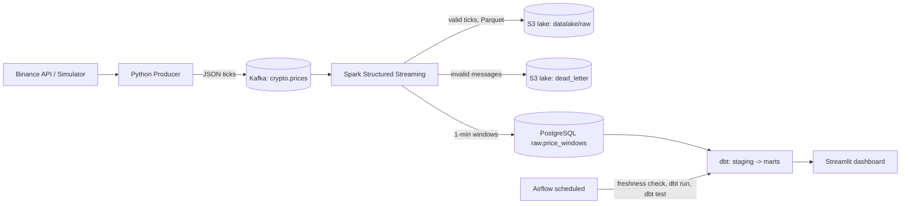
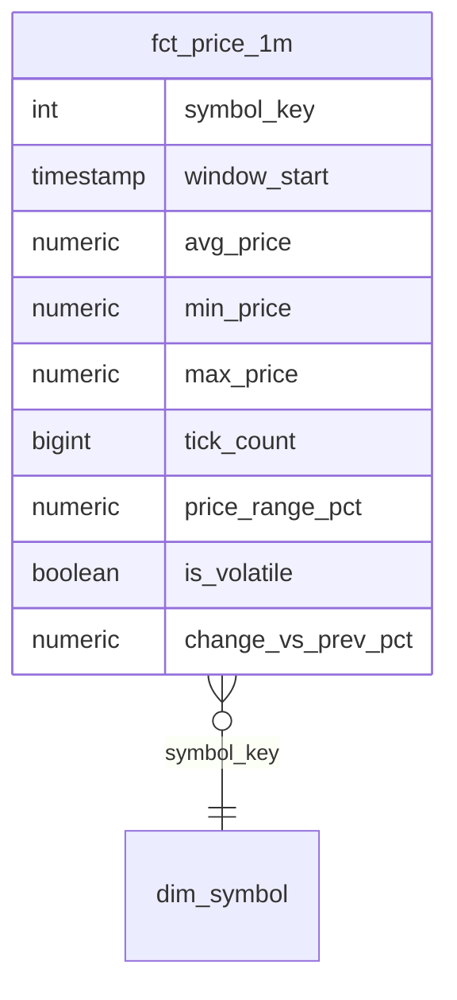
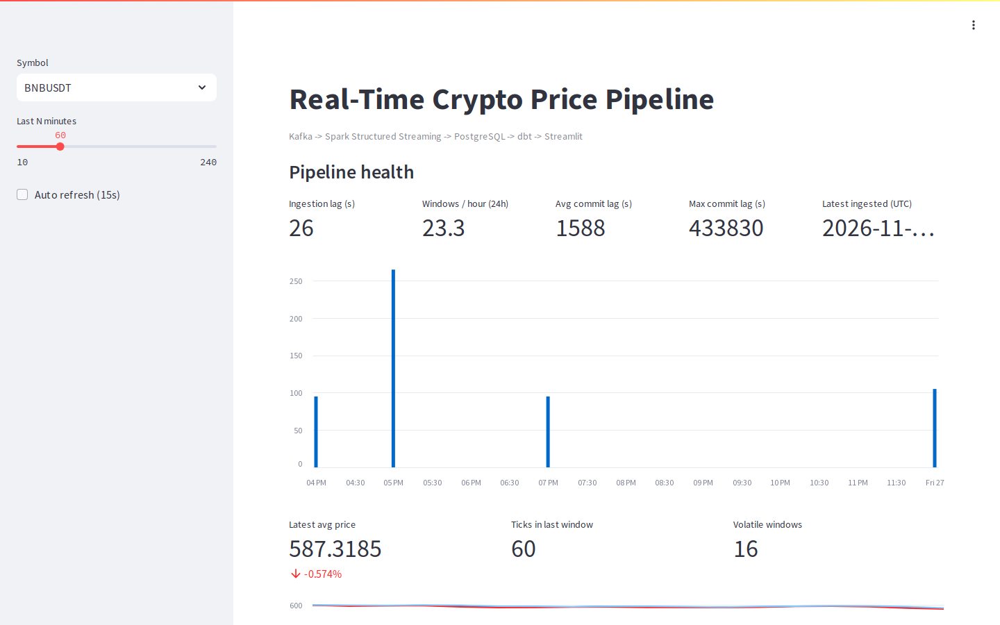
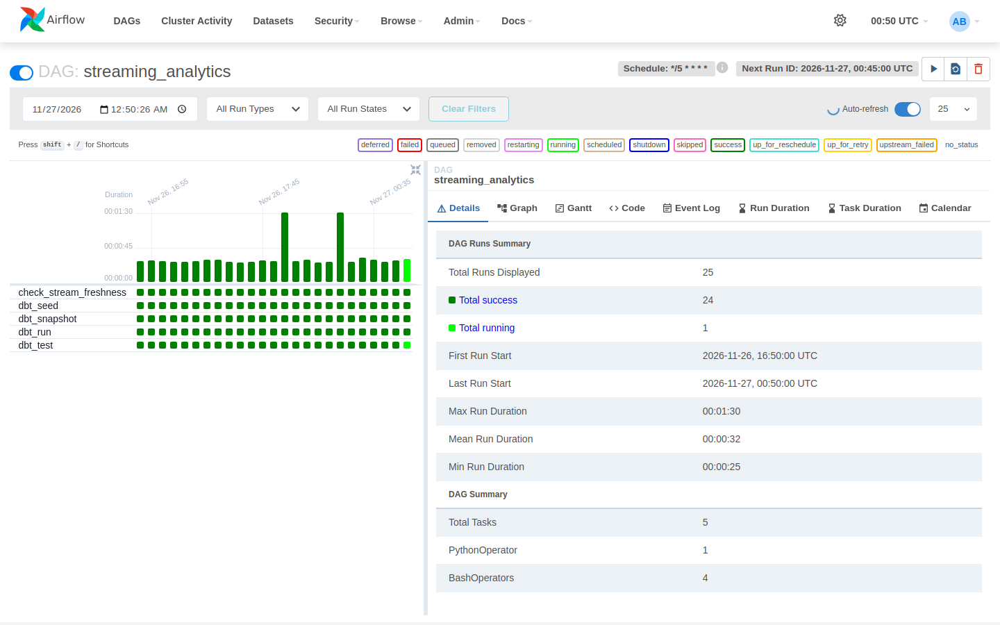
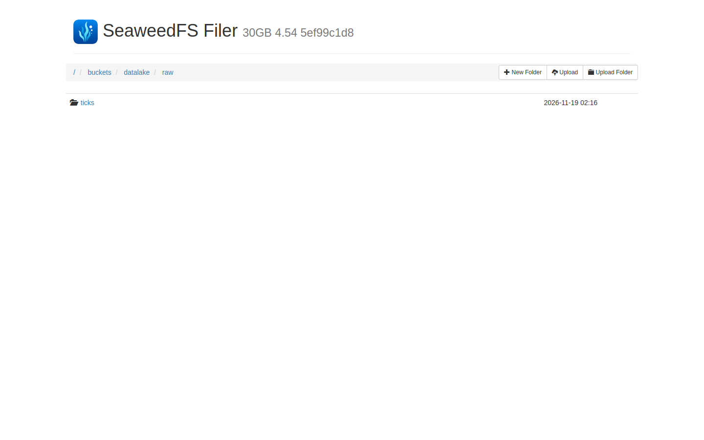

# Real-Time Crypto Price Streaming Pipeline


A local, end-to-end streaming data engineering project: a Python producer publishes crypto
ticks (offline simulator by default, Binance optional) into **Kafka**, **Spark Structured
Streaming** validates them and writes raw Parquet to an **S3-compatible lake (SeaweedFS)**,
1-minute aggregated windows to **PostgreSQL**, and reason-tagged rejections to a dead-letter area.
**dbt** turns the append-only warehouse table into deduplicated staging models, facts, dimensions,
SCD2 history and pipeline metrics; **Airflow** gates the dbt run on a freshness check; and a
**Streamlit** dashboard exposes the results and pipeline health. Everything runs in Docker Compose,
is pinned by version or digest, and is verified by a single eight-check script.

## Architecture





Grain of `fct_price_1m`: **one row per symbol per 1-minute window**. Also built:
`mart_hourly_prices` (OHLC-style), `mart_volatility_alerts`, `mart_symbol_history` (SCD2),
`pipeline_metrics` and `pipeline_windows_per_hour`.

## Screenshots


*Dashboard — "Pipeline health" metrics and the windows-per-hour chart.*


*Airflow — `streaming_analytics` grid view with successful (green) DAG runs.*


*Lake — SeaweedFS filer listing `datalake/raw` with the `ticks` folder.*

## Results (measured)

Every number below comes from a command in [VERIFICATION.md](VERIFICATION.md); none is estimated
except where the row says *projection*.

| Metric | Result | Evidence / note |
|---|---|---|
| End-to-end verification | **8/8 checks passed** | `scripts/verify.ps1`, §6.4 and Step 0 of the Phase 7 section |
| Throughput (simulated, N=505) | **~507 events/s** | 31,310 events / 61.72 s from the Kafka end-offset delta; producer configured at 505 ticks/s (5 base symbols + `SIM_EXTRA_SYMBOLS=500`). §3.2 |
| End-to-end latency (event → warehouse) | **~136 s (about 2 m 16 s)** (135.641074 s measured) | *By design*, not a target: 1-minute watermark + 30 s trigger + JDBC write, plus 5 s deliberately added to the probe's `event_time`. §0.6, §3.3 |
| Raw data in lake | **5,093,976 B (4.858 MiB)** observed over 12.88 h → **~9.05 MiB / 24 h projection** | *A projection, not a measured 24-hour figure.* Mostly the 5-symbol load; the ~4 min N=505 burst is a small part of the window. §3.5 |
| 1-minute windows in warehouse | **4,136** (first 02:16:00, last 15:07:00 UTC) | Snapshot taken during Phase 3. §3.5 |
| dbt tests | **24 passed** (PASS=24, WARN=0, ERROR=0) | Nine observability tests were added in Phase 6 (15 → 24). §6.2, §6.4 |
| Unit tests | **18 passed** by CI's `python -m pytest -q`; **12 passed** with the local `tests/`-only mount | 12 in tests/; 6 more freshness tests in dags/ (18 total) run locally when `dags/` is mounted — CI's root-level command collects all 18 too, and the job is named "pytest (18 tests)". §6.5, §7.6 |
| Full-stack cold boot | **26–36 s** | Four measured boots, jars baked into the image (no Maven/Ivy at startup). §1.2 |

## Quick start

```bash
cp .env.example .env          # Windows: copy .env.example .env
docker compose up -d --build
```

1. Wait about 30 s for a cold start (measured 26–36 s). Check with `docker compose logs -f spark`.
2. In Airflow, unpause `streaming_analytics`. On its schedule it runs: freshness check →
   `dbt seed` → `dbt snapshot` → `dbt run` → `dbt test`.
3. Open the dashboard, or query the warehouse.

| What | Where |
|---|---|
| Airflow (admin / admin) | http://localhost:8080 |
| Lake UI (SeaweedFS filer) | http://localhost:8888 |
| Dashboard | http://localhost:8501 |
| Warehouse (psql) | `docker compose exec warehouse psql -U warehouse -d warehouse` (host port 5433) |

`SOURCE=simulated` is the default: offline and reproducible. Live prices are **optional** — set
`SOURCE=binance` in `.env` (the public API is geo-blocked in some regions) and run
`docker compose up -d --force-recreate producer`. If Binance is blocked, restore `SOURCE=simulated`.
To repeat the throughput test, set `SIM_EXTRA_SYMBOLS=500` before recreating the producer.

### Demo defaults (local development only)

The values committed in `.env.example`, `docker-compose.yml`, `infra/seaweedfs/s3.json` and the
source-code fallbacks are **demo defaults for this local stack only** — S3 `lakeadmin` /
`lakeadmin123`, warehouse `warehouse` / `warehouse`, Airflow `admin` / `admin` with the dummy email
`a@b.com`, and the Flask secret `local-dev-secret-change-me`. They must be overridden in the local
`.env` for any non-local use. `.env` is untracked and never committed; only `.env.example` is.

## Verify everything

After `docker compose up -d` and a few minutes of data flow, one command checks the whole stack —
all nine services up/healthy, Kafka has messages, the lake has `raw/ticks` objects,
`raw.price_windows` has fresh rows, `dbt test` passes, the DAG exists and is unpaused, the
dashboard answers HTTP 200, and `marts.pipeline_metrics` reports ingestion lag within 300 s. It
prints a PASS/FAIL table and exits 1 on any failure; it does not modify data.

```powershell
powershell -ExecutionPolicy Bypass -File scripts/verify.ps1
```

Real output from a run on 2026-11-27 (not edited):

```text
Check                        Result Detail
-----                        ------ ------
services up/healthy          PASS   9/9 up (7 healthy + producer/spark)
kafka has messages           PASS   end offset=363027 (exit=0)
lake raw/ticks objects       PASS   5 event_date partition object(s) listed (exit=0)
raw.price_windows fresh      PASS   rows=6761 max_ingested_at=2026-11-27 00:50:00 age_sec=58 (exit=0)
dbt test passes              PASS   00:51:02  Done. PASS=24 WARN=0 ERROR=0 SKIP=0 NO-OP=0 TOTAL=24
DAG exists & unpaused        PASS   streaming_analytics | /opt/airflow/dags/analytics_pipeline.py | airflow | False
dashboard HTTP 200           PASS   HTTP 200 on port 8501
pipeline_metrics lag <= 300s PASS   latest_ingested_at=2026-11-27 00:51:00 lag_sec=8 limit=300 (exit=0)


SUMMARY: 8/8 checks passed
```

CI runs on every push and PR (`.github/workflows/ci.yml`): ruff, `python -m pytest -q` (18 tests —
12 in `tests/` plus 6 freshness tests in `dags/`; the job is named "pytest (18 tests)"), `dbt parse`,
`docker compose config -q` and `docker compose build`. Local equivalents of those steps are pasted
in [VERIFICATION.md](VERIFICATION.md).

## Observability

The `check_stream_freshness` DAG task measures **ingestion lag** —
`now() - max(raw.price_windows.ingested_at)` — not the age of `window_end`. It fails when the lag
exceeds `FRESHNESS_MAX_LAG_SECONDS` (default 300), so a stalled stream stops dbt instead of quietly
publishing stale marts. A threshold of 1 s was proven to fail the task without touching Spark or
data (§6.1).

Two dbt models are `view`s, so "now" is evaluated at query time:

| View | Purpose |
|---|---|
| `marts.pipeline_metrics` | `latest_ingested_at`, `ingestion_lag_seconds`, `windows_last_24h`, `windows_per_hour_last_24h` (= count / 24), `avg_commit_lag_seconds`, `max_commit_lag_seconds` (`ingested_at - window_end`, over all rows) |
| `marts.pipeline_windows_per_hour` | One row per hour with at least one ingested window in the last 24 h — powers the dashboard chart |

The Streamlit **Pipeline health** section shows ingestion lag, windows/hour, average and max
commit lag, and the per-hour chart. How to read it (§6.3):

- Ingestion lag of a few seconds to about a minute is healthy; approaching 300 s means Spark or
  the JDBC sink has stopped committing.
- Commit lag in the tens of seconds is expected (watermark + trigger + JDBC). A large **max**
  usually means a window was replayed from the Spark checkpoint after a restart — the measured
  82,980 s max came from a window committed late after a restart.
- A drop in windows/hour means fewer windows are being committed for the configured symbols.

Dead-letter count is deliberately **not** a metric: dead letters are Parquet objects under
`dead_letter/` in the lake, not a SQL relation, so counting them from dbt would need an S3 scan.
Inspect them in the lake UI or with `scripts/replay_dlq.py --dry-run`.

## Design decisions

General choices:

- **Kafka as the buffer:** producer and processor are decoupled; Spark resumes from its checkpoint.
- **Idempotent producer** (`enable.idempotence`, `acks=all`) avoids duplicates on retry.
- **Event-time windows + 1-minute watermark:** late data is handled by event time, not arrival time.
- **At-least-once into Postgres, dedupe in dbt:** after a restart a window can be written twice.
  `stg_price_windows` keeps the latest row per (symbol, window_start); a source-level dbt test warns
  if the append-only raw table contains duplicates (§4.3).
- **Dead-letter storage:** malformed or invalid messages are written to `dead_letter/` with a reason
  and their Kafka coordinates instead of being dropped; `replay_dlq.py` can repair and replay them.
- **Raw ticks kept in date-partitioned Parquet:** the lake is the source of truth, so the warehouse
  can be rebuilt.
- **dbt in its own venv inside the Airflow image:** avoids dependency conflicts with Airflow.
- **SCD2 via snapshot:** `check` strategy on display name, asset class and active flag; `dim_symbol`
  shows only the current version, `mart_symbol_history` every version.
- **Freshness check before dbt:** if streaming silently stops, the DAG fails instead of modelling
  stale data.

Lessons learned the hard way (each was reproduced and fixed, with evidence in VERIFICATION.md):

- **MinIO images were removed upstream** (Docker Hub 404, `dl.min.io` 410, quay 401 — §0.2).
  The lake moved to **SeaweedFS**, pinned by digest. It speaks S3, so Spark's `s3a://` path was
  unchanged. `minio/mc` was also replaced by a boto3-based `scripts/init_lake.py`.
- **Pin dbt-core and dbt-postgres together** (§1.4). `dbt-postgres==1.8.2` had no upper bound and
  pulled a dbt-core 2.x release candidate whose `dbt-oss` CLI refused the postgres adapter; both are
  now pinned to 1.11.0 and shared across the Airflow services.
- **Spark's Parquet file sink can drift from its checkpoint** (§2.2). After a schema change and a
  dead-letter checkpoint reset, a leftover `_spark_metadata` log with higher batch ids made Spark
  silently skip every new batch. Dead letters now use `foreachBatch(write_dead_letter)` with a plain
  partitioned Parquet write, so there is no metadata log to drift.
- **Use output-committer v2 on S3-compatible stores** (§2.2). Version 1's `commitJob` re-merged stale
  `_temporary` directories and crashed the stream with `FileNotFoundException`; v2 commits per task.
- **At-least-once + dedupe is simpler than exactly-once here** (§2.5, §4.3): a failed JDBC batch is
  quarantined to `dead_letter/sink_failures/`, re-raised for retry, and dbt dedupes the append-only
  source. No data is lost and no transaction spans Kafka, S3 and Postgres.

## Limitations

- **Single node:** one Kafka broker, one Spark driver, one Postgres and one SeaweedFS instance on
  Docker Desktop. No replication, no high availability, no scaling tests beyond N=505.
- **Simulated source by default:** `SOURCE=simulated` is what makes the project offline and
  reproducible; the Binance path is optional and was not the source of the measured results.
- **No cloud deploy:** everything runs locally in Docker Compose; the S3 API is SeaweedFS, not AWS
  S3, and there is no infrastructure-as-code or production secret management.
- **Windows-only verify script:** `scripts/verify.ps1` is PowerShell, so it runs on Windows only;
  the checks it makes can be run by hand with the `docker compose` commands in
  [VERIFICATION.md](VERIFICATION.md).

## Roadmap

- [ ] Incremental dbt models instead of full-table rebuilds
- [ ] Great Expectations / Soda checks on the lake
- [ ] Prometheus + Grafana for Kafka lag and Spark metrics
- [ ] Deploy on a cloud VM with real AWS S3

## Tests

Host Python is 3.14 and the pinned dependencies do not build there, so tests and lint run inside
the producer image in containers. The long commands below are split with a **bash backslash**
(`\`) for line continuation; in PowerShell use a trailing backtick (`` ` ``) instead. What they
run is unchanged:

```bash
docker compose run --rm --no-deps \
  -v "${PWD}/tests:/app/tests" \
  -v "${PWD}/dbt:/app/dbt" \
  producer sh -c "pip install -q pytest==8.3.2 && python -m pytest -q"
docker compose run --rm --no-deps \
  -v "${PWD}:/work" \
  -w /work \
  producer sh -c "pip install -q ruff==0.6.4 && ruff check ."
```

dbt tests run inside Airflow (`dbt test`): not_null, unique, relationships, plus singular tests
and the pipeline-metrics sanity test.

## Data note

By default the pipeline generates simulated prices (no real market data), and all measured results
come from the simulator. Live prices are optional with `SOURCE=binance` (Binance public market-data
endpoint, no API key, no personal data; availability depends on region). This project is for
learning and is not financial advice.
