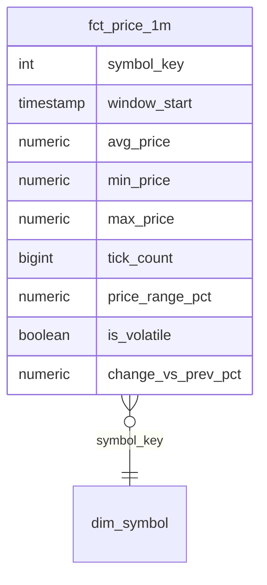

# Real-Time Crypto Price Streaming Pipeline

End-to-end streaming data engineering project: **Kafka -> Spark Structured Streaming -> S3-compatible lake (SeaweedFS) + PostgreSQL -> dbt -> Airflow -> Streamlit**.

It reads live prices from the public Binance API (or a built-in simulator), streams them through Kafka, aggregates them into 1-minute windows with Spark, lands raw data in an S3-compatible lake, models it with dbt, and monitors freshness and quality with Airflow.

## Architecture


## Data model (dbt marts)


Grain of `fct_price_1m`: **one row per symbol per 1-minute window**. Also: `mart_hourly_prices` (OHLC-style) and `mart_volatility_alerts`.

## Stack
Kafka (KRaft) · Spark 3.5 Structured Streaming · SeaweedFS (S3 API) · PostgreSQL 16 · dbt-postgres · Apache Airflow 2.10 · Streamlit · Docker Compose · pytest · ruff · GitHub Actions

## Quick start

```bash
cp .env.example .env          # Windows: copy .env.example .env
docker compose up -d --build
```

| What | Where |
|---|---|
| Airflow (admin / admin) | http://localhost:8080 |
| Lake UI (SeaweedFS filer) | http://localhost:8888 || Dashboard | http://localhost:8501 |
| Warehouse (psql) | `docker compose exec warehouse psql -U warehouse -d warehouse` (host port 5433) |

1. Wait ~30 s for a cold start (Spark's Kafka/S3/JDBC jars are baked into the image at build time; no Maven/Ivy download on first start). Check: `docker compose logs -f spark`.
2. In Airflow, unpause `streaming_analytics`. It runs every 5 minutes: freshness check -> `dbt seed` -> `dbt snapshot` -> `dbt run` -> `dbt test`.
3. Open the dashboard.

If Binance is blocked in your region, set `SOURCE=simulated` in `.env` and run `docker compose up -d --force-recreate producer`.

### Throughput test
Set `SOURCE=simulated` and `SIM_EXTRA_SYMBOLS=500` to generate ~505 events/sec (5 base symbols + 500 extra), then record the numbers in the Results table.

## SCD Type 2 demo (slowly changing dimension)

Symbol attributes (display name, asset class, active flag) live in `dbt/seeds/symbol_metadata.csv`. A dbt **snapshot** (`check` strategy) keeps the full history: when an attribute changes, the old row is closed (`dbt_valid_to`) and a new row is opened (`dbt_valid_from`). `dim_symbol` shows only the current version; `mart_symbol_history` shows every version.

Try it:
```bash
# 1. change a row, e.g. set SOLUSDT asset_class to "Layer 1"
# 2. let the DAG run (or trigger it); it runs: dbt seed -> dbt snapshot -> dbt run -> dbt test
docker compose exec warehouse psql -U warehouse -d warehouse -c \
 "SELECT symbol, asset_class, valid_from, valid_to, is_current
  FROM marts.mart_symbol_history WHERE symbol='SOLUSDT';"
```
You should see two rows: the old version with a `valid_to`, and the new current one.

## Design decisions
- **Kafka as the buffer:** the producer and the processing job are decoupled; Spark can restart and resume from its checkpoint.
- **Idempotent producer** (`enable.idempotence`, `acks=all`) avoids duplicates on retry.
- **Event-time windows + 1-minute watermark:** late data is handled by event time, not arrival time.
- **At-least-once into Postgres, dedupe in dbt:** after a Spark restart a window can be written twice. `stg_price_windows` keeps the latest row per (symbol, window_start); a source-level dbt test warns if the raw table contains duplicate (symbol, window_start) rows.
- **Dead-letter storage:** malformed or invalid messages are written to `dead_letter/` in the lake instead of being dropped.
- **Raw ticks kept in Parquet (partitioned by date):** the lake is the source of truth, so the warehouse can be rebuilt.
- **dbt in its own venv inside the Airflow image:** avoids dependency conflicts with Airflow.
- **SCD Type 2 via snapshot:** history of dimension attributes is kept without custom merge code, and facts always join to the current version.
- **Freshness check before dbt:** if streaming silently stops, the DAG fails instead of modelling stale data.

## Break it on purpose (dead-letter demo)
```bash
docker compose exec kafka /opt/kafka/bin/kafka-console-producer.sh \
  --bootstrap-server kafka:9092 --topic crypto.prices
# type:  {"symbol":"BTCUSDT","price":-5,"event_time":"2026-11-19T10:00:00+00:00"}
# type:  not json at all
```
After ~30 s both messages appear under `datalake/dead_letter/` in the lake, and the valid stream is unaffected.

## Tests
```bash
pip install -r requirements-dev.txt
pytest -q
ruff check .
```
dbt tests run inside Airflow (`dbt test`): not_null, unique, relationships, plus singular tests (prices positive, min <= avg <= max).

## Results (fill in after your own run)
| Metric | Value |
|---|---|
| Events/sec (simulated, N symbols) | ~507 events/s (N=505; Kafka end-offset delta 31,310 over 61.72 s; producer logs +505/s) |
| End-to-end latency (event -> warehouse) | 135.641074 s (2 m 15.6 s) — by design: 1-min watermark + 30 s trigger (probe `LATENCYPROBEUSDT`, `event_time` 15:06:44.368926 UTC -> `ingested_at` 15:09:00.01 UTC) |
| Raw data in lake after 24h | ~9.05 MiB **projection** from mostly the 5-symbol load, not 505 (5,093,976 B / 4.858 MiB observed over 12.88 h under `raw/ticks/`; not a measured 24 h figure; the ~4 min N=505 burst is a small part of that window) |
| 1-minute windows in warehouse | 4,136 (first 02:16:00, last 15:07:00 UTC) |
| dbt tests passed | 15 (PASS=15, WARN=0, ERROR=0, TOTAL=15) |
| Unit tests | 12 passed in 0.99s |

Add screenshots: Airflow DAG green, dashboard, lake bucket.

## Roadmap
- [x] SCD Type 2 on symbol attributes (dbt snapshot), see below
- [ ] Incremental dbt models instead of full-table rebuilds
- [ ] Great Expectations / Soda checks on the lake
- [ ] Prometheus + Grafana for Kafka lag and Spark metrics
- [ ] Deploy on a cloud VM with real AWS S3

## Data note
Prices come from Binance's public market-data endpoint (no key, no personal data). This project is for learning and is not financial advice.
